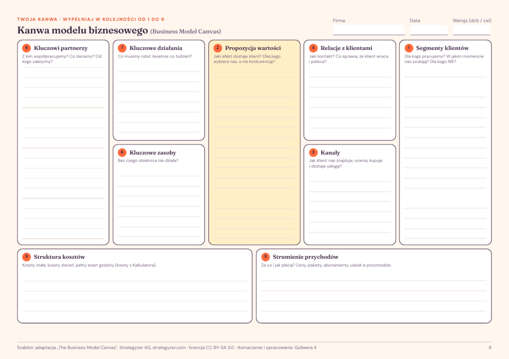

# Kierunek Zysk · PDF-y wersja 2 (narzędzia)

W tym folderze są **tylko narzędzia i podglądy**. Treść płatnych materiałów (źródła HTML, gotowe PDF-y) jest przechowywana prywatnie, poza repozytorium. Nie dodawaj jej tutaj.

## Co jest w środku

| Plik | Do czego |
|---|---|
| `narzedzia/g4-workbook.css` | Wspólny styl workbooków w identyfikacji Guliwera 4 (paleta v3, Fraunces / DM Sans / Caveat): strony A4 pionowe i poziome, karty, kanwy, checklisty, objaśnienia pól, stopka z numerem strony |
| `narzedzia/build_pdf.js` | HTML → PDF (Chromium przez Playwright): klikalne linki, zakładki, PDF z tagami. Sprawdza przepełnione ramki i treść wychodzącą poza stronę. Numery stron w spisie treści (`.spis a .s`) wylicza sam z kotwic. Zapisuje mapę pól (`data-f` = pole tekstowe, `data-cb` = checkbox) |
| `narzedzia/twarde_spacje.py` | Twarde spacje w liczbach (9 900 zł) i po jednoliterowych spójnikach, tylko w tekście (nie w znacznikach) |
| `narzedzia/acroform.js` | Dodaje pola formularza (AcroForm) w miejscach z mapy. Pola mają osadzony font DM Sans, więc przyjmują polskie znaki. Ustawia metadane PDF |
| `podglady/` | Podgląd okładki i pustego szablonu kanwy modelu biznesowego |

## Budowanie

```bash
cd pdf-kierunek-zysk/narzedzia && npm install
# źródła HTML w ../src (prywatne), fonty WOFF2 z @fontsource w ../src/fonts,
# DMSans_400Regular.ttf (np. z @expo-google-fonts/dm-sans) w ../src/fonts-pola
node build_pdf.js 03_Strategia_na_1_stronie.html 3_Strategia_na_1_stronie.pdf
node acroform.js ../PDF/3_Strategia_na_1_stronie.pdf "Kierunek Zysk · Strategia na 1 stronie (wersja 2.0)"
```

Fonty: [Fraunces](https://fonts.google.com/specimen/Fraunces), [DM Sans](https://fonts.google.com/specimen/DM+Sans), [Caveat](https://fonts.google.com/specimen/Caveat) (SIL OFL 1.1).

## Opis zmian

### Przewodnik z ćwiczeniami 2.0 (do akceptacji)
- 26 stron w identyfikacji Guliwera 4, klikalny spis treści i zakładki, strona redakcyjna z dopiskiem o AI.
- Każdy moduł: otwarcie z czasem, arkuszem Kalkulatora i decyzją; ćwiczenia z przykładem Studio Lumen obok pola na własną odpowiedź; „Koniec modułu” z checklistą.
- Nowe elementy: przykłady tam, gdzie ich brakowało (wycieki zysku, ocena segmentów, karta klienta, mapa zmian, plan podwyżki, lejek, terminy przeglądów), porównanie 12 liczb po 90 dniach, checklista końcowa.
- 357 pól do wypełnienia w PDF.
- Liczby ujednolicone z Kalkulatorem i Strategią (zapytania ok. 30/mies., nowe zlecenia ok. 35 tys. zł/mies., cel 50 tys. zł/mies.).


### Strategia na 1 stronie 2.0 (zaakceptowana 23.11.2026)
- 17 stron zamiast 2: okładka, spis treści z linkami, strona redakcyjna, „jak korzystać” (czas, poziom, druk / tablet).
- Część 1: Business Model Canvas. Objaśnienie 9 pól (co wpisać, pytania pomocnicze, przykład, czego unikać), kolejność wypełniania, przykład wypełniony, pusty szablon, checklista spójności.
- Część 2: dopasowanie oferty do klienta (na podstawie koncepcji Value Proposition Canvas) z przykładem i szablonem, zdanie wartości.
- Część 3: strategia na 1 stronie. 14 pól z pytaniami, błędami i źródłem odpowiedzi (moduł przewodnika, arkusz kalkulatora), przykład i szablon.
- Checklista końcowa, rytm przeglądów, „co dalej”, słowniczek, źródła i licencje.
- 61 pól do wypełnienia w PDF, fonty marki osadzone, dopisek o AI na stronie redakcyjnej.
- Liczby przykładu zgodne z przewodnikiem i Kalkulatorem Zysku.
- Maskotka: Wafel G4 (`brand/wafel-g4/pozy/`, pozy „myśli” i „brawo”), zgodnie z decyzją z 22.11.2026. Wektorowy Wafel z archiwum nie jest używany.
- Szablon kanwy modelu biznesowego jest adaptacją „The Business Model Canvas” (Strategyzer AG, CC BY-SA 3.0).



